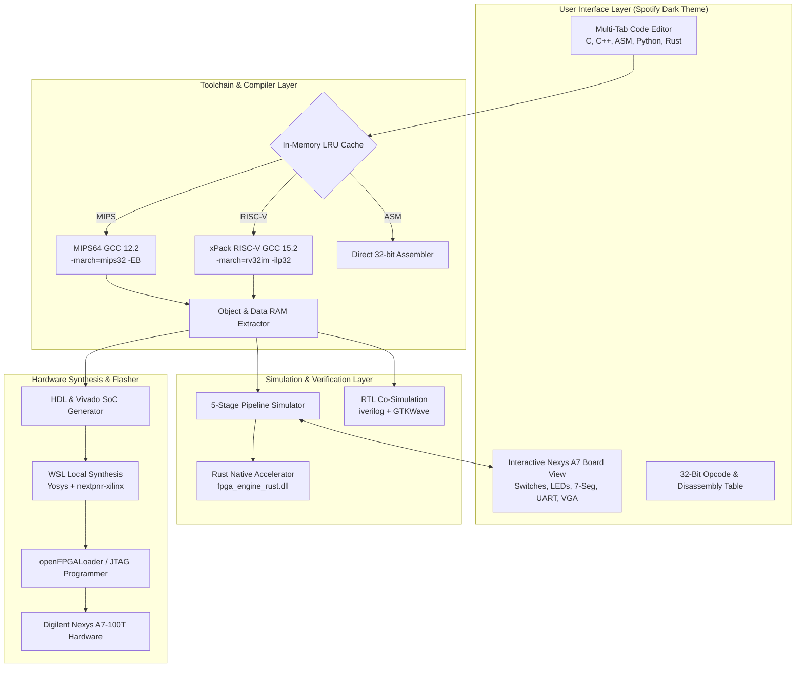

# ⚡ FPGA Studio (Spotify Dark Edition)

[](https://github.com/posweeza558/fpga-studio-cloud)
[](https://digilent.com/reference/programmable-logic/nexys-a7/start)
[](https://github.com/posweeza558/fpga-studio-cloud)
[](LICENSE)

**FPGA Studio** is an all-in-one, zero-dependency Integrated Development & Educational EDA Studio for designing, programming, simulating, and deploying 32-bit RISC CPU systems onto FPGA hardware.

Designed with a modern **Spotify Dark Theme UI** (VS Code-like experience), it eliminates the steep learning curve and massive installation footprint (60–80 GB) of traditional FPGA toolchains.

---

## 🚀 Key Features

* **Dual Industrial 32-Bit Architectures**:
  * **OpenMIPS (MIPS32 Release 1)**: 5-stage pipeline, Big-Endian, Branch Delay Slot, signed/unsigned hardware multiplier & divider.
  * **RISC-V (RV32IM)**: 5-stage pipeline, Little-Endian, M-Extension (`mul`, `mulh`, `div`, `rem`), synchronous active-high reset.
* **Offline Real GCC Toolchains (Bundled)**:
  * Real `mips64-elf-gcc` (GCC 12.2.0) and `riscv-none-elf-gcc` (GCC 15.2.0-1).
  * High-performance in-memory LRU compilation cache (**0 ms latency**).
  * Automatic bare-metal startup routine (`start.S`) and linker script (`link.ld`).
  * Automatic `.data` memory extraction and word-aligned BRAM initialization.
* **Multi-Language Programming**:
  * C / C++ (with standard bare-metal UART `printf` support).
  * Direct 32-bit Assembly (`.s` / `.asm`) with real-time bit-field disassembler.
  * Python (`.py`) & Rust (`.rs`) subset transpilation to bare-metal execution.
* **Interactive Digilent Nexys A7 Virtual Board**:
  * 16 interactive slide switches (`0xF0000004`) with click-and-toggle control.
  * 16 glowing user LEDs (`0xF0000000`).
  * 8-digit multiplexed 7-segment display with dynamic BCD and raw cathode decoding (`0xF0000008`).
  * 5 pushbuttons (BTNC, BTNU, BTNL, BTNR, BTND) + CPU reset latch (`0xF000000C`).
  * Live serial UART Terminal console at 115200 baud (`0xF0000010`).
  * 640x480 Virtual VGA framebuffer display (`0xFF000000`).
* **Ultra-Fast Simulation (Dual-Backend)**:
  * Pure Python cycle-accurate 5-stage pipeline simulator (IF, ID, EX, MEM, WB with data forwarding & hazard detection).
  * **Rust Native Engine (`fpga_engine_rust.dll`)** via C-ABI / ctypes FFI for **50x–100x speedup** (>50M cycles/sec).
* **Zero-Vivado Local WSL Synthesis (openXC7)**:
  * Synthesize Verilog directly to Artix-7 `.bit` bitstreams offline using **Yosys** + **nextpnr-xilinx** inside Windows Subsystem for Linux (WSL).
* **1-Click Hardware Flasher**:
  * Direct JTAG flashing via bundled **openFPGALoader**, Digilent Adept (`djtgcfg`), or Vivado CLI batch mode.
  * **Live USB-UART RAM Bootloader (`uart_prog_loader.v`)**: updates CPU software in Block RAM on real FPGA hardware within 1 second without resynthesizing bitstreams!
* **Custom CPU Import & Auto-Inspection**:
  * AST parser in `hdl_analyzer.py` automatically inspects Verilog/VHDL modules, identifies I/O bus signals (`clk`, `rst`, `addr`, `din`, `dout`, `we`), classifies Standalone ALU vs. SoC CPU, and binds ports to virtual board peripherals via `cpu_manifest.json`.

---

## 🏛️ System Architecture



---

## 📁 Repository Structure

```
fpga_studio/
├── config/                         # Theme styling, catalog paths, and starter templates
├── core/                           # Core calculation, simulation, and toolchain engines
│   ├── gcc_toolchain.py            # GCC MIPS/RISC-V integration, linker scripts & caching
│   ├── simulator_engine.py         # 5-stage pipeline simulator with MMIO bus routing
│   ├── rust_accel.py               # C-ABI bridge to Rust acceleration library
│   ├── fpga_engine_rust.dll        # High-performance compiled Rust simulation backend
│   ├── hdl_generator.py            # Generates synthesizable VHDL/Verilog ROM & Vivado SoC
│   ├── hdl_analyzer.py             # AST parser for custom CPU port auto-inspection
│   ├── wsl_synthesis.py            # Local offline synthesis engine (Yosys + openXC7)
│   ├── fpga_programmer.py          # 1-click JTAG flasher (openFPGALoader, Adept, Vivado)
│   └── transpiler.py               # Python & Rust subset transpiler to bare-metal C
├── custom_cpus/                    # Built-in 32-bit CPU Verilog cores
│   ├── openmips/                   # Full OpenMIPS 32-bit core (5-stage pipeline, MULT/DIV)
│   └── riscv/                      # Synthesizable RISC-V RV32IM core
├── bitstreams/                     # Tested, ready-to-flash bitstreams for Nexys A7-100T
├── ui/                             # Graphical User Interface (Tkinter / Custom widgets)
├── vscode_app.py                   # Main application entry point
├── FPGA Studio.spec                # PyInstaller packaging configuration
├── installer.iss                   # Inno Setup 6 installer compilation script
└── FPGA_Studio_System_Architecture_and_Features_Guide.md # Full Developer Manual
```

---

## 📥 Download & Installation

For most users, simply download the pre-packaged Windows installer and run it:
* 🚀 **[Download FPGA Studio v4.2 Installer (.exe)](https://github.com/posweeza558/fpga-studio-cloud/releases/latest)** *(Self-contained, includes offline GCC toolchains, bitstreams, and simulators)*

---

## 🛠️ Running from Source (For Developers)

If you want to modify or contribute to the source code:
1. Clone the repository:
   ```bash
   git clone https://github.com/posweeza558/fpga-studio-cloud.git
   cd fpga-studio-cloud
   ```
2. Install Python dependencies:
   ```bash
   pip install pyserial
   ```
3. Run the application:
   ```bash
   python vscode_app.py
   ```

---

## 📖 Complete Developer & Architecture Guide
For full technical implementation details, RTL pipeline stage schematics, MMIO memory map, and developer extension guides, please refer to:  
👉 [**FPGA_Studio_System_Architecture_and_Features_Guide.md**](FPGA_Studio_System_Architecture_and_Features_Guide.md)
